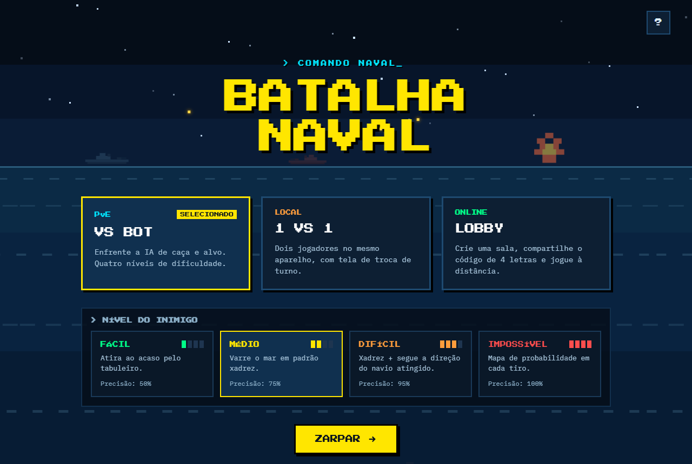
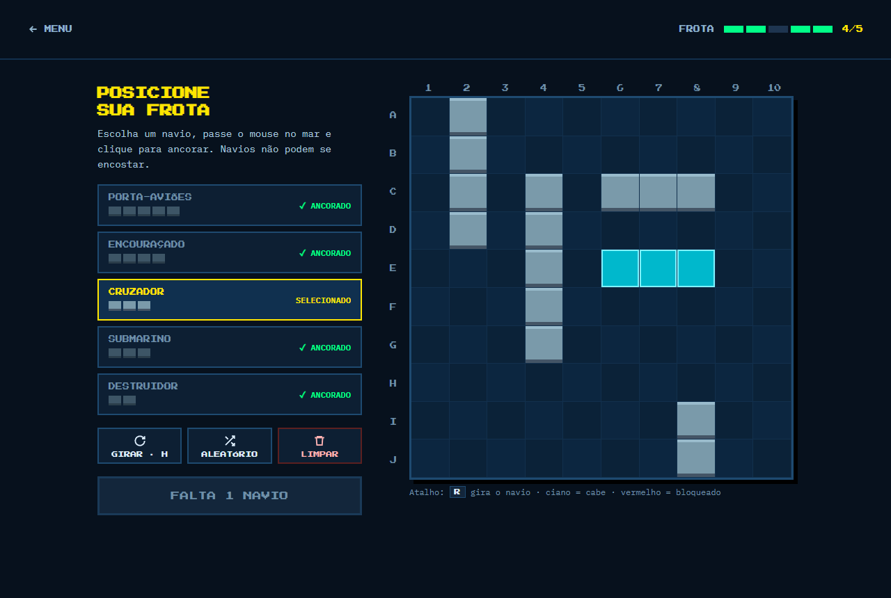
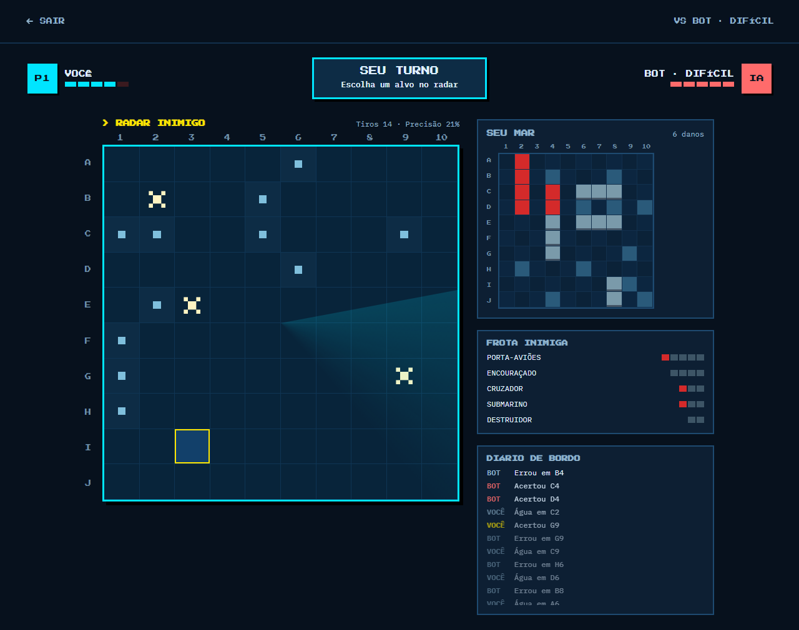
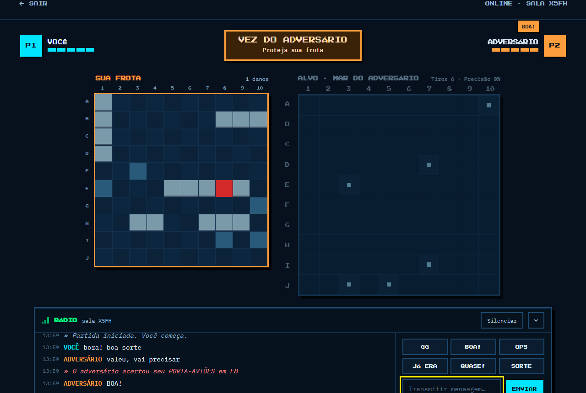
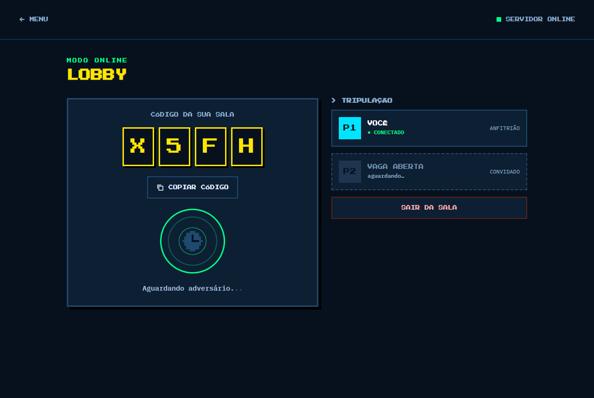
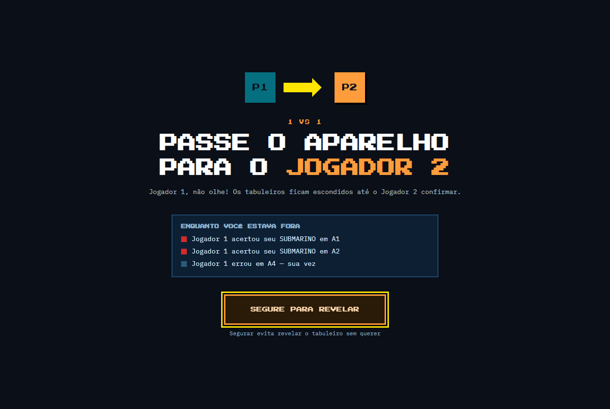
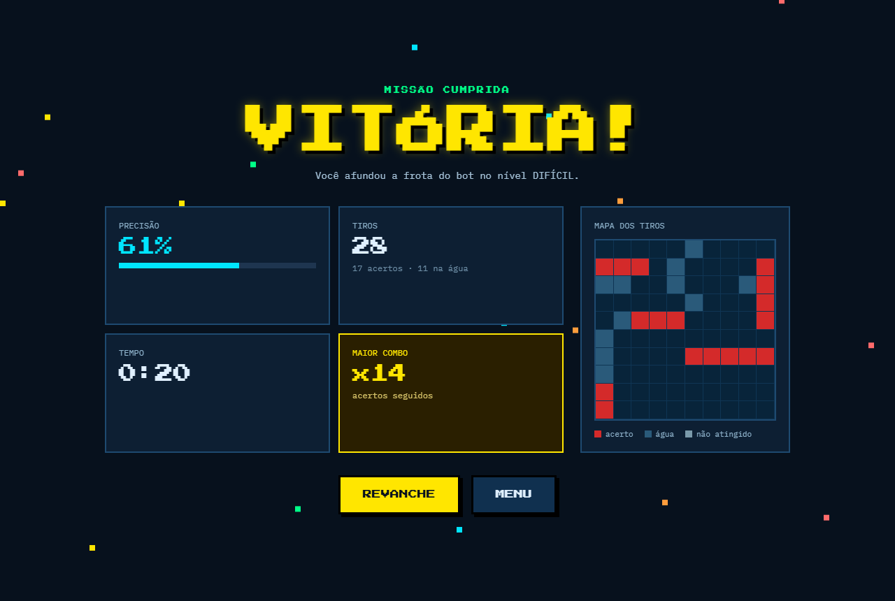
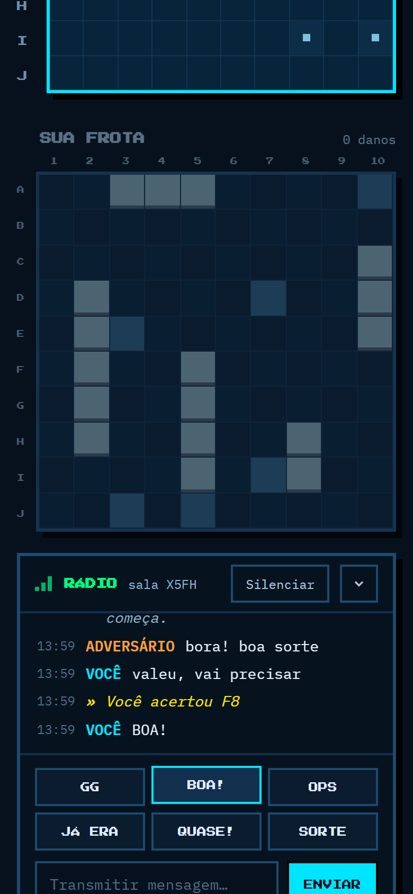

<h1>Batalha Naval — Jogo OpenSource & Online</h1>

Projeto de <strong>Batalha Naval</strong> em HTML, CSS e JavaScript. Tem três modos: contra a máquina (PvE), com uma IA baseada em estratégias <em>hunt/target</em>; 1 vs 1 local (PvP) no mesmo dispositivo; e <strong>online</strong>, com lobby por código via Socket.IO.

<section>
	<h2>Telas</h2>
	<table>
		<tr>
			<td> Posicionamento da frota</td>
			<td> Batalha contra o bot</td>
		</tr>
		<tr>
			<td> Partida online com o rádio (chat)</td>
			<td> Lobby online</td>
		</tr>
		<tr>
			<td> Troca de aparelho no 1 VS 1</td>
			<td> Resultado da partida</td>
		</tr>
	</table>
	
 Também funciona no celular

</section>

<section>
	<h2>Recursos</h2>
	<ul>
		<li>Posicionamento manual ou aleatório de navios.</li>
		<li>Modo PvE com IA em níveis de dificuldade configuráveis.</li>
		<li>Modo PvP local com overlay para troca de jogador.</li>
		<li>Modo online: crie um lobby, compartilhe o código de 4 caracteres e jogue em outro dispositivo, com chat entre os jogadores.</li>
		<li>Regra: ao acertar um navio, o jogador continua jogando até errar.</li>
		<li>Feedback visual (acertos, erros, afundados) e log de batalha.</li>
	</ul>
</section>

<section>
	<h2>VERCEL</h2>
	
O jogo está disponível na Vercel para teste: <a href="https://batalha-naval-game-three.vercel.app/" target="_blank" rel="noopener noreferrer">Jogo</a>

	
Para publicar sua própria versão (front na Vercel + servidor online), siga o guia <a href="docs/deploy-vercel.md"><code>docs/deploy-vercel.md</code></a>.

</section>

<section>
	<h2>Instalação e execução local</h2>
	<h3>Pré-requisitos</h3>
	<ul>
		<li><a href="https://nodejs.org/">Node.js</a> 18 ou superior (inclui o npm).</li>
		<li>Git.</li>
	</ul>

	<h3>Passo a passo</h3>
<pre><code>git clone https://github.com/FernandoHaeser/batalha-naval-game.git
cd batalha-naval-game
npm install
npm start
</code></pre>
	
Abra <a href="http://localhost:3000">http://localhost:3000</a>. O mesmo servidor entrega o front e o modo online, sem nenhuma configuração extra.

	<h3>Testar o modo online localmente</h3>
	<ol>
		<li>Abra <code>http://localhost:3000</code> em duas abas (ou em outro dispositivo da mesma rede usando <code>http://&lt;IP-da-sua-máquina&gt;:3000</code>).</li>
		<li>Na primeira aba: <strong>ONLINE → Criar lobby</strong> e copie o código.</li>
		<li>Na segunda aba: <strong>ONLINE</strong>, cole o código e entre.</li>
		<li>Posicione os navios nas duas abas. A partida começa pelo Jogador 1 (quem criou o lobby).</li>
	</ol>

	<h3>Variáveis de ambiente (opcionais)</h3>
	<table>
		<tr><th>Variável</th><th>Padrão</th><th>Descrição</th></tr>
		<tr><td><code>PORT</code></td><td><code>3000</code></td><td>Porta do servidor.</td></tr>
		<tr><td><code>CORS_ORIGIN</code></td><td>qualquer origem</td><td>Origens permitidas no Socket.IO, separadas por vírgula. Use quando o front estiver em outro domínio (ex.: Vercel).</td></tr>
		<tr><td><code>SOCKET_SERVER_URL</code></td><td>vazio (mesmo domínio)</td><td>Usada só no build do front (<code>npm run build:config</code>) para apontar para um servidor online externo.</td></tr>
	</table>
	
Exemplo (PowerShell): <code>$env:PORT=4000; npm start</code> · (bash): <code>PORT=4000 npm start</code>

</section>

<section>
	<h2>Controles</h2>
	<ul>
		<li>Clique nas células para posicionar ou atacar.</li>
		<li>Durante o posicionamento, pressione <code>R</code> para rotacionar o navio selecionado.</li>
		<li>Use os botões na interface para limpar, posicionamento aleatório e confirmar quando estiver pronto.</li>
	</ul>
</section>

<section>
	<h2>Regras do jogo</h2>
	<ul>
		<li>Cada jogador possui um conjunto de navios com tamanhos pré-definidos.</li>
		<li>Ao atacar, se o jogador acertar uma célula com parte de um navio, ele tem direito a jogar novamente; somente ao errar o turno passa ao adversário.</li>
		<li>O objetivo é afundar todos os navios do oponente.</li>
	</ul>
</section>

<section>
	<h2>Estrutura do projeto</h2>
	<ul>
		<li><code>server.js</code>: servidor Express + Socket.IO (serve o front e controla lobbies, turnos, ataques e chat do modo online).</li>
		<li><code>public/index.html</code>: interface do jogo.</li>
		<li><code>public/style.css</code>: folhas de estilo e tema visual.</li>
		<li><code>public/js/</code>: lógica do jogo no navegador, separada por modo (veja <a href="docs/client-code.md">código do cliente</a>).</li>
		<li><code>public/config.js</code>: URL do servidor online usada pelo front (gerada no build da Vercel).</li>
		<li><code>public/assets/</code>: imagens (favicon).</li>
		<li><code>scripts/build-config.js</code>: gera <code>public/config.js</code> a partir de <code>SOCKET_SERVER_URL</code>.</li>
		<li><code>vercel.json</code> / <code>.vercelignore</code>: deploy do front estático na Vercel.</li>
		<li><code>render.yaml</code>: deploy do servidor online no Render.</li>
		<li><code>docs/images/</code>: capturas de tela usadas neste README.</li>
		<li><code>docs/</code>: documentação técnica (<a href="docs/interface.md">interface</a>, <a href="docs/client-code.md">código do cliente</a>, <a href="docs/online-mode.md">modo online</a>, <a href="docs/deploy-vercel.md">deploy</a>).</li>
	</ul>
</section>

<section>
	<h2>Contribuições</h2>
	
Pull requests são bem-vindos. Para alterações de comportamento do jogo, prefira mudanças pequenas e testáveis. Se for adicionar uma feature grande, abra uma issue primeiro para discutir o design. O código não leva comentários: documente o que for necessário em arquivos <code>.md</code> dentro de <code>docs/</code>.

</section>

<section>
	<h2>Licença</h2>
	
Distribuído sob a licença <a href="LICENSE">MIT</a>.

</section>
